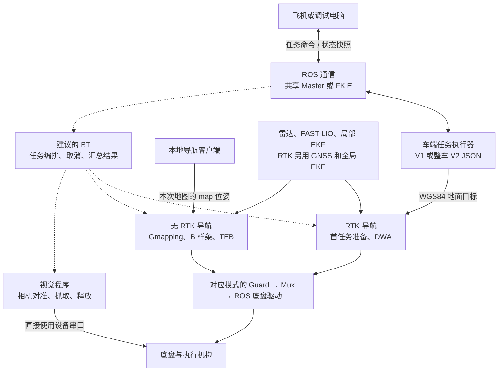

# BT 行为树开发接入指南

初次接入可以从[无设备测试](#4-开发和测试快速开始)开始。选定导航模式后，按速查表找到目标坐标、调用入口和完成判据。

## 1. 十分钟认识小车



实线是当前入口，虚线是 BT 直接编排时的建议接线。首版也可以通过现有执行器委托导航，再接视觉。两种导航按场地择一启动，同一导航 Action 每次只交给一个任务执行入口。

局部 EKF 负责 `odom → base_link`。RTK 模式由全局 EKF 负责 `map → odom`，无 RTK 模式由 Gmapping 负责这条边。无 RTK 重建地图后，要在新地图上确认录点。运行入口见[操作手册](OPERATIONS.md)，发布与实车状态见[共同交接](../HANDOFF.md)。

## 2. 小车能力接口速查

### 导航和停车

两套导航都用 `move_base_msgs/MoveBaseAction`，目标字段是 `target_pose`（`geometry_msgs/PoseStamped`）。按下表选择 Action 名和坐标。

| 能力 | 调用、类型和输入 | 完成、失败和取消 | 源码与验证 |
| --- | --- | --- | --- |
| RTK 首任务自动配准 | 按[手册](OPERATIONS.md#rtk-导航与空地接口)启动定位与底盘，再运行 `roslaunch ugv_bringup slicer_navigation_runtime.launch`。Action `/geographic/prepare`（`ugv_navigation/PrepareGeographicAction`），输入 `task_id` 和 `target_json`（`latitude`、`longitude` 为 WGS84 度数）。通常由 V1、整车 V2 或 WGS84 CLI 调用。 | 准备阶段用 `odom` 短程采样。停稳并确认全局定位后切 `map`，由调用方继续派发原目标。后续任务复用有效配准。反馈和结果 有 `phase`、`reason`。`READY` 表示可发正式目标，`FAILED` 表示准备失败，确认取消后返回 `STOPPED`。 | [Action 定义](../src/ugv_navigation/action/PrepareGeographic.action) · [运行器](../src/ugv_navigation/scripts/navigation_runtime.py)。CLI、V1/V2 接续及取消已有隔离证据。[配准验收] |
| WGS84 到点 | `rosrun ugv_navigation geographic.py send --target-file "$MARK"`。`$MARK` 是 `geographic.py capture --output` 保存的目标 JSON。也可同时传 `--latitude`、`--longitude`、`--altitude-ellipsoid`。目标是 `base_link` 要到达的 WGS84 地面点。准备后用当前配准转成 `map` 位姿，发给 `/ugv/move_base`。 | 终点需 Action `SUCCEEDED`、新鲜 `/odom` 确认停稳、合格 RTK 地理复核都通过。CLI 输出 JSON，退出码 0 表示通过。超时或定位失效会取消执行中的目标，Ctrl+C 请求取消本次调用。`plan` 只查 `/ugv/move_base/make_plan`（`nav_msgs/GetPlan`）。 | [CLI](../src/ugv_navigation/scripts/geographic.py) · [地理复核](../src/ugv_navigation/scripts/geographic_goal_core.py)。软件接续已验证，RC1 未拿到 Fixed，自动配准、全局纠偏和 WGS84 到点待实车验收。[配准验收] · [RC1 现场] |
| 无 RTK 导航与在线建图 | `./tools/no_rtk.sh nav` 启动在线 Gmapping、B 样条和 TEB。`/move_base` 收本次 `map` 的 x/y（米）与朝向。`send_goal.py --relative` 可把 `base_link` 相对目标一次性转到 `map`，yaw 用弧度。地图输出 `/map`（`nav_msgs/OccupancyGrid`）。 | 用 Action 跟踪 `SUCCEEDED`、`ABORTED` 等终态，取消见下行。发点脚本只负责发出目标。建图可观察 `/map` 与 TF 持续更新。 | [在线 launch](../src/slicer_navigation_without_mapping/launch/slicer_nav_without_mapping.launch) · [发点客户端](../src/slicer_navigation_without_mapping/scripts/send_goal.py)。RC1 已实车出图、短程到点和停车。[RC1 现场] |
| 避障 | 随导航运行。两套代价地图都用 `/scan`（`sensor_msgs/LaserScan`，按消息 frame 通过 TF 投影）。可订阅 Action 名下的 `/local_costmap/costmap`（`nav_msgs/OccupancyGrid`）和 `/slicer_nav_arc_guard/hold_reason`（`std_msgs/String`）。 | 规划器尝试绕行，Guard 会按本模式限制或拦停速度。Guard 的停车原因是诊断，任务终态看导航 Action。通过取消导航目标结束本次运动。 | [RTK Guard](../src/ugv_slicer_control/scripts/arc_velocity_guard.py) · [无 RTK Guard](../src/slicer_navigation/scripts/arc_velocity_guard.py)。已有[模拟标障和清障用例](../src/slicer_navigation_without_mapping/tests/integration.py)，RC1 验证过 Guard/Mux 停车，RTK 绕障和停车距离待现场验证。[RC1 现场] · [配准验收] |
| 暂停与取消 | 任务层用 V1 `PAUSE` / `RESUME` / `CANCEL` 或整车 V2 `PAUSE` / `RESUME` / `STOP`，输入当前 `task_id`。直接用任一 MoveBase Action 时，通过 actionlib 取消自己发的 goal。 | 等 `PAUSING → PAUSED` 后再恢复，保留的路线会重新导航。取消/STOP 要等停稳和 `CANCELED` / `STOPPED`。直接 Action 客户端也要等取消确认和停稳。`LOST` 或超时按未确认处理。直接调用时由调用方保存目标供恢复。 | [V1 执行器](../src/ugv_navigation/scripts/air_ground_executor.py) · [V2 执行器](../src/ag_ugv_task/src/ag_ugv_task/executor.py)。隔离测试覆盖暂停、恢复和取消。[配准验收] |

### 视觉、状态与底盘交接

| 能力 | 调用、类型和输入 | 完成、失败和取消 | 源码与验证 |
| --- | --- | --- | --- |
| 视觉对准、抓取与释放 | `rosrun slicer_visual_grasp run.sh --run --headless`。保持 stdin 打开，逐条写入并刷新 `pick` / `release`（每条换行），stdout 有 `GRASP_STATE`。对准合在 `pick` 内，用相机像素、吸嘴原点和本机标定。释放沿用持物及升降记录。ROS Action/Service 封装待做。 | `busy` 执行中，`held` 表示吸附并抬升结束，本次 `release` 正常结束的 `idle` 表示释放完成。`error` / `recovery` 要处理异常或残余行程。SIGINT/SIGTERM 请求中断，等进程清理和串口释放。启动或中断也可能报 `idle`，须结合本次请求和进程状态判断。进程退出后仍可能保持持物，重启后会读取恢复记录。 | [进程接口](../src/slicer_visual_grasp/src/slicer_visual_grasp/headless.py) · [视觉流程](../src/slicer_visual_grasp/src/slicer_visual_grasp/pipeline.py) · [标定说明](../src/slicer_visual_grasp/README.md)。已有假设备回归，RC1 相机与预览已验，工件抓取和完整释放待补。[RC1 现场] |
| 定位与车辆状态 | 两种模式看 `/odom`、`/wheel/odom`（`nav_msgs/Odometry`，`odom → base_link`）和 `/slicer_c30d_driver/ready`（`std_msgs/Bool`）。RTK 另看 `/global/odom`（同上，`map`）、`/gnss/fix`（`sensor_msgs/NavSatFix`，WGS84）、`/gnss/fix_quality`（`diagnostic_msgs/DiagnosticArray`）和 `/geographic/status`、`/geographic/navigation_runtime`（`std_msgs/String` JSON）。 | 这些是观测 Topic。检查消息新鲜度、驱动就绪和连续静止，RTK 再看合格 Fixed、配准和当前导航模式。状态过期或退化时保留原因。 | [局部定位](../src/slicer_bringup/launch/sensors.launch) · [GNSS](../src/cup_gnss/scripts/gnss_node.py) · [全局定位](../src/ugv_navigation/scripts/gnss_global.py)。RC1 已验局部定位和驱动反馈，Fixed 相关验收待补。[RC1 现场] |
| 底盘控制权交接 | ROS 链路为 `/cmd_vel/nav_raw → Guard → /cmd_vel/nav → Mux → /cmd_vel`，各速度 Topic 用 `geometry_msgs/Twist`，车体线速度 m/s 和角速度 rad/s。RTK 可用 `rosrun ugv_slicer_control control.py state`、`hold`、`release`，读写 `/cup_nav/manual_state`、`/cup_nav/manual_intent`（`std_msgs/String` JSON）。 | Mux 独占 `/cmd_vel`。RTK 归还时核对 Mux 实例和接管代次，保留外部停车或急停。无 RTK Mux 按遥控、任务、导航仲裁，输入过期归零。转给视觉或独立遥控时先结束导航并停稳，等驱动释放底盘串口。 | [RTK 交接客户端](../src/ugv_slicer_control/scripts/control.py) · [无 RTK Mux](../src/slicer_wasd_control/scripts/velocity_mux.py) · [桌面视觉交接](../tools/rtk/desktop/workflow.py)。RC1 已验停车与手柄接管，视觉交接有隔离回归。[RC1 现场] · [桌面交接验收](handoffs/RTK_DESKTOP_GRASP_INDEPENDENT_20261122.md) |

### 空地通信与任务反馈

| 版本 | 入口与消息 | 坐标、结果和验证 |
| --- | --- | --- |
| 整车 V1 | `roslaunch ugv_bringup slicer_air_ground.launch`。`/air_ground/command` 是 [`slicer_air_ground_msgs/Command`](../src/slicer_air_ground_msgs/msg/Command.msg)，`/air_ground/state` 是 `std_msgs/String` JSON。 | [GeoPoint](../src/slicer_air_ground_msgs/msg/GeoPoint.msg) 是 WGS84 地面目标。命令用车端的 `server_id`、递增 `sequence` 和 `request_id`。看 `last_command` 受理结果、`phase` 和 `last_task_result`。`COMPLETED` 为终点复核通过，`BLOCKED` 留原因，`CANCELED` 已取消。通过隔离 ROS 和历史局域网回执验证，飞机联调待验。[V1 手册](rtk/air_ground_interface_v1.md) · [接收节点](../src/ugv_navigation/scripts/air_ground_node.py) |
| 整车 V2 JSON | `roslaunch ag_ugv_task ugv.launch monitor_only:=false` 启用执行，共享 Master 时加 `start_fkie:=false`。`/air_ground/v2/command`、`/air_ground/v2/state`、`/air_ground/v2/uav_state` 都是 `std_msgs/String` JSON。 | `SET_TARGET` 和 MVP 用 WGS84 `lat`、`lon`。用 `task_id` 和 `seq` 匹配 `last_command`，按 `task_id` 跟踪 `phase`，终态看 `COMPLETED`、`STOPPED`，`BLOCKED` 看 `reason`。`monitor_only:=true` 只发布定位快照，任务阶段为 `IDLE`。已有隔离 ROS 接续验证，飞机联调待验。[V2 协议] · [接收节点](../src/ag_ugv_task/src/ag_ugv_task/node.py) |
| 无人机组独立 typed V2 | 独立 `AG_Client` 工作区。`command` 用 `slicer_air_ground_msgs/V2Command`，`state`、`uav_state` 用 `slicer_air_ground_msgs/V2State`。 | 导航也用 WGS84 地面点。同名话题的 ROS 类型和 MD5 不同，接入整车前需双方对齐协议。已核对独立提交 `bd6f04c`，其执行端在路线校验时需要已配准的 `map` 位姿。跨团队联调待验。[V2 协议] |

共享 Master 时可直连命令和状态。双 Master 按对应白名单运行 [V1 FKIE](../src/ugv_communication/config/sync_topics.yaml) 或 [V2 FKIE](../src/ag_uav_client/config/fkie_sync.yaml)。整车 V2 的 `/air_ground/v2/uav_intent` 在飞机本机用 `std_msgs/String` JSON 交给 gateway。可在调试机上用 `rosrun ag_uav_client v2_send.py` 模拟飞机发意图。导航 Action、TF 和控制接口接在车端 Master。[V2 下发示例](../src/ag_uav_client/docs/implementation_guide.md#只读验收和下发)

## 3. BT 如何组织一项任务

建议从“电脑代飞机发一项任务，车端到目标区，视觉对准后抓取或放置，再上报结果”开始。下表是 BT 接法建议。

| BT 步骤 | RUNNING | SUCCESS | FAILURE |
| --- | --- | --- | --- |
| 接收任务 | 等待约定协议中的任务。 | 校验坐标和任务 ID，通过后记录本次任务。 | 协议、字段或目标无效，记录具体拒绝原因。 |
| 导航 | 进入节点时发一次目标，之后轮询归属本任务的进度。RTK 准备、行驶和停车复核都算运行中。 | RTK 用任务 `COMPLETED` 或 CLI 复核结果，无 RTK 用本次 Action `SUCCEEDED`。转视觉前还要确认车辆停稳。 | `BLOCKED`、Action 失败、超时或到点复核失败。等取消及停车确认后再决定下一步。 |
| 对准并抓取 / 放置 | 串口交接完成后，用视觉进程的 `pick`（含对准）或 `release`，跟踪本次请求的 `busy`。 | 本次请求正常结束后的 `held` 或释放后的 `idle`。确认串口归还和驱动就绪后可继续导航。 | `error`、`recovery`、进程异常退出或超时。保留恢复信息和停车状态。 |
| 上报结果 | 由适配层把进度和原因关联到 `task_id`。 | 将整项任务的终态交给约定的上报入口。 | 上报接口失败时单独保留结果和发送错误。 |

首版可让现有 V1 或 V2 执行器接收任务并导航，BT 按 `task_id` 读取快照并接续视觉，暂停和取消沿用同一命令入口。若由 BT 直接发 Action，先结束旧任务并停用相应执行器。执行器的 `COMPLETED` 对应导航结束，抓取或投送的整项结果需要适配层上报。

交接可参考 RTK 桌面流程。等导航、配准和空地任务空闲，确认停稳并保持停车，再由驱动所有者停驱动、释放串口。视觉动作完成后确认串口空闲，恢复驱动且确认就绪。RTK 只解除本次建立、实例和代次仍匹配的 hold。BT 被中止时，取消所拥有的准备/导航 goal，或通过任务协议请求停止。视觉用进程的中断与恢复语义，停稳或清理仍未确认时留在停车状态。[桌面交接源码](../tools/rtk/desktop/workflow.py)

## 4. 开发和测试快速开始

整车主线是 `origin/main`，环境为 Ubuntu 20.04 / ROS1 Noetic 与 Catkin。先按[依赖说明](DEPENDENCIES.md)配置 rosdep 与 vcs。在已有整车主检出的机器上单开终端，建立独立开发区。

```bash
BASE="$HOME/workspace/slicer"
MAIN="$BASE/main/src/slicer-ugv"
W="$BASE/dev/bt-dev"
git -C "$MAIN" fetch origin main
git -C "$MAIN" worktree add -b feat/bt-dev "$W/src/slicer-ugv" origin/main
(cd "$W" && vcs import . < src/slicer-ugv/dependencies.repos)
source /opt/ros/noetic/setup.bash
rosdep update --include-eol-distros --rosdistro noetic
rosdep install --from-paths "$W/src" --ignore-src --rosdistro noetic -y
cd "$W/src/slicer-ugv"
bash tools/build_native.sh "$W" -j2
source "$W/install/setup.bash"
rospack find ugv_navigation
```

`rospack find` 应解析到本任务的 `install/share`。源码、构建、安装和 `runtime` 参数都使用同一开发区。完整步骤见[根 README](../README.md#从克隆到构建)。

从仓库根目录运行以下入口。先跑离线单测，再加载本工作区的安装跑 ROS 用例。

| 想验证的环节 | 已有无设备入口 |
| --- | --- |
| 空地协议、路线、地理和控制逻辑 | `bash tools/check_offline.sh`。需要 NumPy、PyYAML、PyQt5，无需 ROS Master 或整车构建。[脚本](../tools/check_offline.sh) |
| 首任务自动配准与到点 | `python3 src/ugv_navigation/test/check_auto_registration_ros.py cli`。自建 loopback Master，模拟 RTK、扫描和底盘反馈。将 `cli` 换为 `v1` 或 `v2` 可验证任务入口。[用例](../src/ugv_navigation/test/check_auto_registration_ros.py) |
| V2 消息往返和暂停 / 恢复 | `python3 src/ag_ugv_task/test/check_v2_ros.py`。自建 loopback Master，软件 gateway 配合假导航后端。[用例](../src/ag_ugv_task/test/check_v2_ros.py) |
| 无 RTK 在线地图、规划和 Guard | 在独立 loopback Master 下运行 `python3 src/slicer_navigation_without_mapping/tests/integration.py "$W/runtime/no_rtk"`。用模拟雷达/位姿与 mock 底盘。[用例](../src/slicer_navigation_without_mapping/tests/integration.py) |
| 视觉抓取与释放 | `rosrun slicer_visual_grasp run.sh --test`。使用假相机、底盘和气泵。[测试入口](../src/slicer_visual_grasp/run.sh) |

无 RTK 用例在两个已加载同一安装的终端执行 `export ROS_MASTER_URI=http://127.0.0.1:11321 ROS_IP=127.0.0.1` 和 `unset ROS_HOSTNAME`。选空闲端口，在一个终端运行 `roscore -p 11321`，另一个运行测试。结束后 Ctrl+C 关闭该 Master。

## 5. 待讨论的接口问题

1. **BT 和 V2 的任务边界。** 确定 V2 是否继续管理路线和导航执行，或由 BT 接管执行并通过适配层反馈任务状态。与飞机组先定 JSON 或 typed V2 的消息来源，以及 `task_id`、受理、停止和整项完成的映射。[V2 协议]
2. **视觉动作的结果与中断。** 给现有进程加 BT 适配，约定对准进度、抓取和释放终态、取消完成与 `recovery` 的交接。当前 `pick` 把对准和抓取合在一起，单独对准需要先确定接口。[视觉程序](../src/slicer_visual_grasp/src/slicer_visual_grasp/headless.py)
3. **导航与串口的所有权。** 选定每个 Action 的唯一发目标端，定义取消并确认停稳、交出串口、恢复驱动的时序。RTK 的自动配准和外部 hold 沿用现有判据。[配准验收] · [桌面交接源码](../tools/rtk/desktop/workflow.py)

[配准验收]: handoffs/RTK_AUTO_REGISTRATION.md
[RC1 现场]: handoffs/RC1_FIELD_ACCEPTANCE_20261122.md
[V2 协议]: ../src/ag_uav_client/docs/protocol_v2.md
